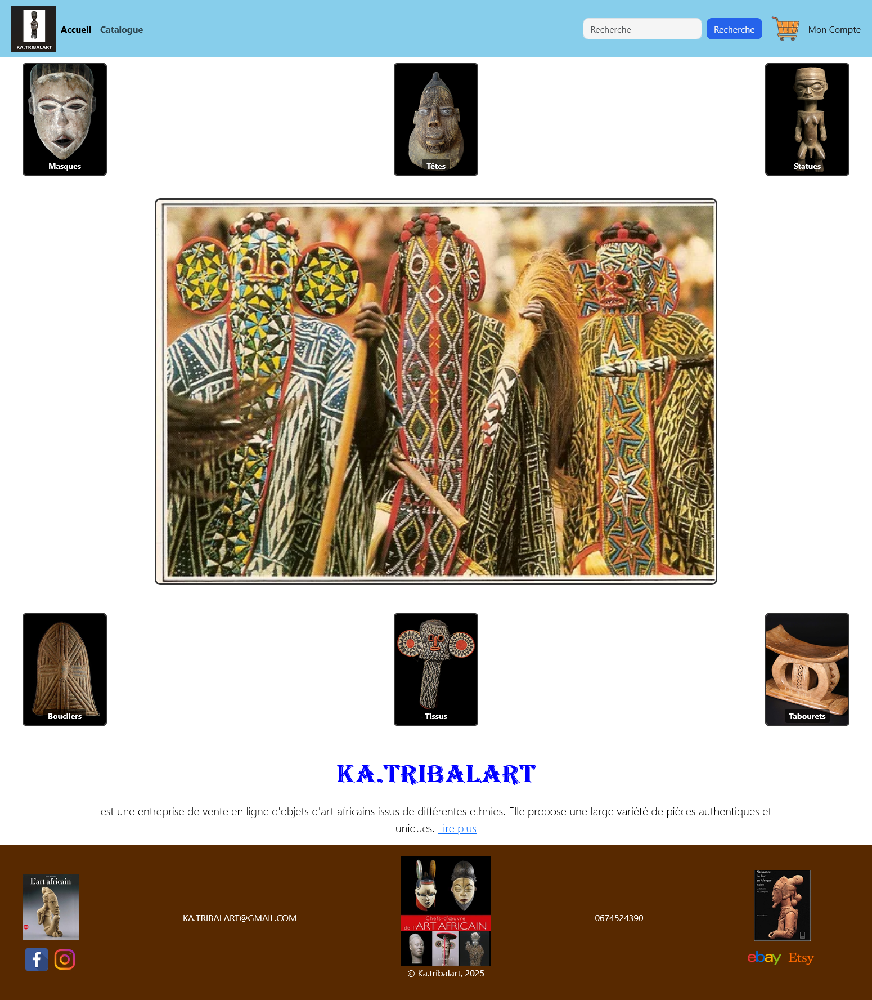
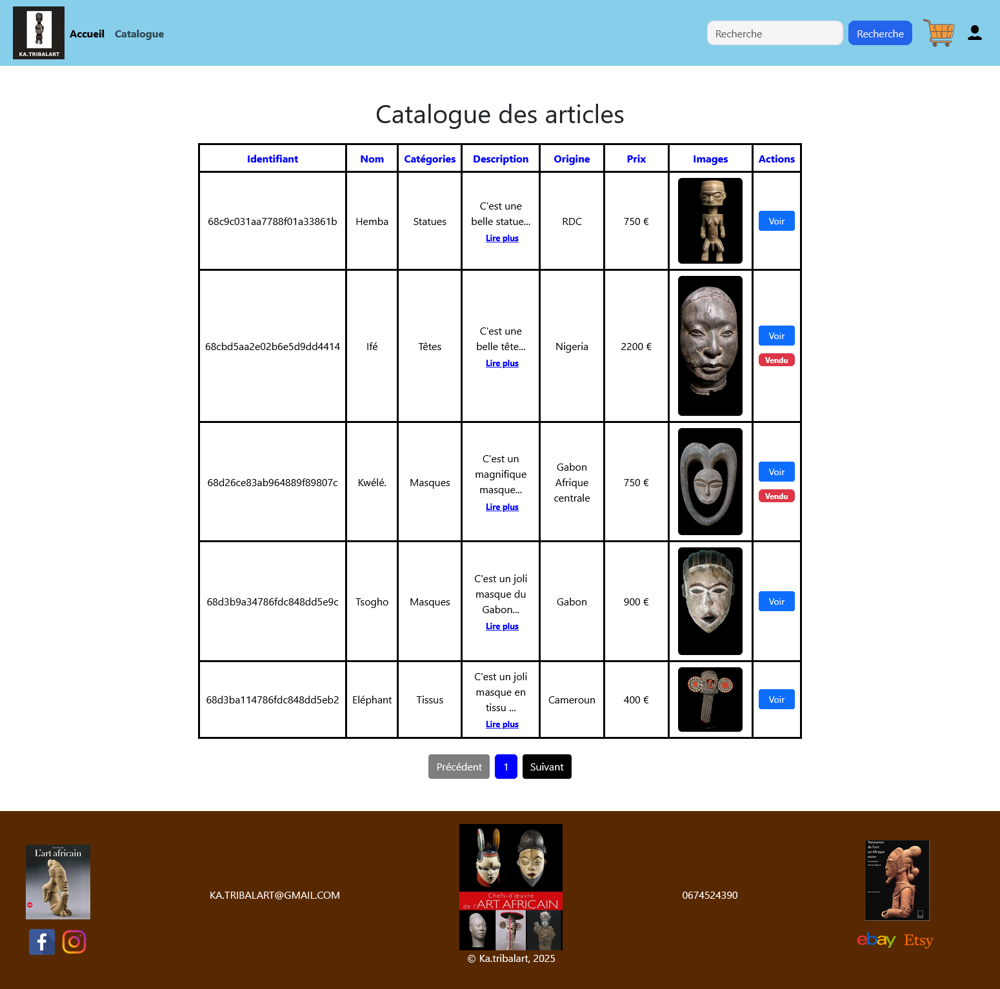
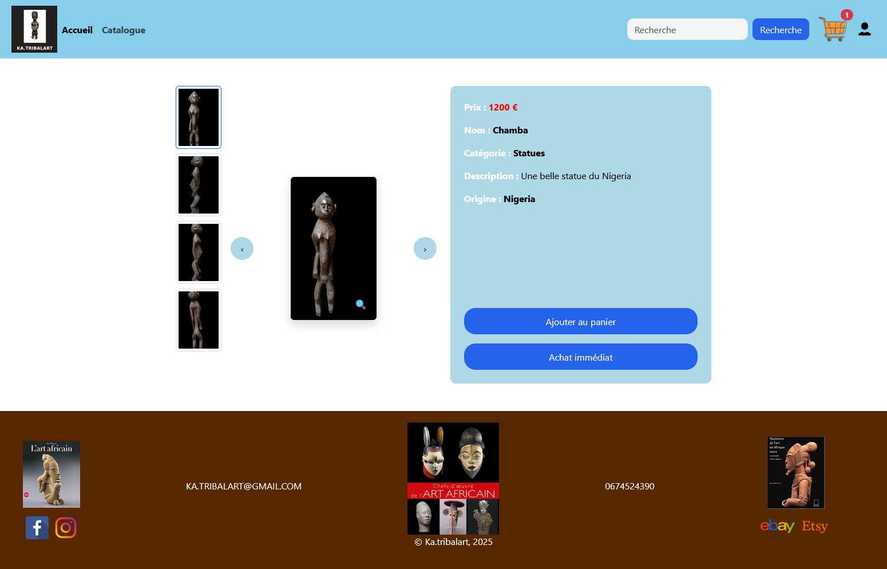
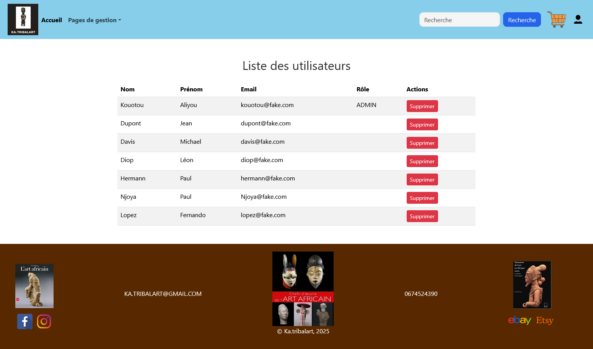
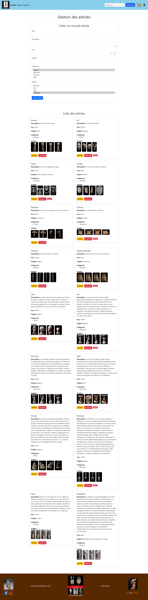

# 🎨 KA.TRIBALART - Plateforme E-commerce d'Objets d'Art Africain

## 📌 Présentation

**KA.TRIBALART** est une plateforme e-commerce full-stack dédiée à la vente d’objets d’art africain authentiques (masques, statues, têtes, etc.).

Le projet est développé avec :
- **Backend** : Node.js + Express.js + MongoDB
- **Frontend** : React.js (Vite)

Il propose une gestion complète des articles, un système d’authentification avec rôles, un panier d’achat et une simulation de paiement.

---

## 🎯 Objectifs

- Valoriser le patrimoine artistique africain
- Offrir une expérience d’achat fluide et moderne
- Permettre une administration complète des produits et commandes
- Respecter les bonnes pratiques (architecture MVC, sécurité JWT, validation des données)

---

## 🚀 Fonctionnalités principales

### 👤 Espace Visiteur / Client
- Navigation intuitive
- Catalogue avec pagination et recherche
- Fiche article détaillée (images multiples, description, prix, origine)
- Ajout au panier
- Passation de commande
- Simulation de paiement Stripe

### 🛠️ Espace Admin
- CRUD complet sur les articles
- Gestion des catégories
- Gestion des commandes
- Gestion des utilisateurs et rôles
- Upload d’images

### 🔐 Authentification
- Inscription / Connexion
- Rôles : Admin / Client
- Protection des routes (middleware)

---

## 🛠️ Technologies utilisées

| Couche          | Technologies                                      |
|-----------------|---------------------------------------------------|
| **Backend**     | Node.js, Express.js, Mongoose, JWT, Multer       |
| **Frontend**    | React.js, Vite, Context API, Axios               |
| **Base de données** | MongoDB                                       |
| **Paiement**    | Stripe                                            |
| **Sécurité**    | Bcrypt, JWT, Validation (Joi)                     |
| **Autres**      | Bootstrap 5, Multer (upload images)               |

---

## 📁 Structure du projet

### 🟢 Backend (Node.js)
```bash
node_fil_rouge_ka_tribalart/
├── controllers/             # article.controller.js, user.controller.js...
├── db/
│   └── db.js
├── middlewares/             # authMiddleware.js, adminMiddleware.js, multer.js
├── models/                  # article.model.js, user.model.js...
├── routes/                  # article.route.js...
├── uploads/                 # Images uploadées
├── validations/             # article.validation.js...
├── .env
├── package.json
└── server.js

```

### 🔵 Frontend (React)
```bash
react_fil_rouge_ka_tribalart/
├── public/
│   ├── images/              # Captures d'écran et images du site
│   └── vite.svg
├── src/
│   ├── assets/
│   ├── components/          # Header, Footer, etc.
│   ├── contexts/            # AuthContext.jsx, PanierContext.jsx
│   ├── pages/               # PageAccueil, PageCatalogue, PageArticle...
│   ├── App.jsx
│   ├── App.css
│   ├── index.css
│   └── main.jsx
├── index.html
├── package.json
├── vite.config.js
└── README.md

```

## 📷 Captures d'écran

### 🏠 Page d'accueil


### 📋 Catalogue des articles


### 🖼️ Fiche Article détaillée


### 👥 Gestion des Utilisateurs


### 🎭 Gestion des articles



---

## 💻 Installation et Lancement

### 1. Cloner les projets

```bash
# Frontend
git clone https://github.com/ALIYOU65/react_fil_rouge_ka_tribalart.git

# Backend
git clone https://github.com/ALIYOU65/node_fil_rouge_ka_tribalart.git
```

### 2. Installer et lancer le backend

```bash
cd node_fil_rouge_ka_tribalart
npm install
```

Créer un fichier `.env` :

```env
MONGO_URI=...
JWT_SECRET=...
STRIPE_SECRET_KEY=...
```

Puis lancer le serveur :

```bash
npm run dev
```

### 3. Installer et lancer le frontend

```bash
cd react_fil_rouge_ka_tribalart
npm install
npm run dev
```

## 📈 Améliorations prévues

- ✅ Paiement Stripe en mode production
- ⭐ Système d'avis et de notation des articles
- 🔎 Recherche avancée avec filtres multicritères
- 📊 Tableau de bord administrateur avec statistiques
- ☁️ Déploiement de l'application (Frontend : Vercel, Backend : Render ou Railway)

---

## 👨‍💻 Auteur

**KOUOTOU ALIYOU**  
Développeur Full Stack Web & Mobile

📧 Email : ali3bakar@gmail.com  
🔗 [GitHub](https://github.com/ALIYOU65)