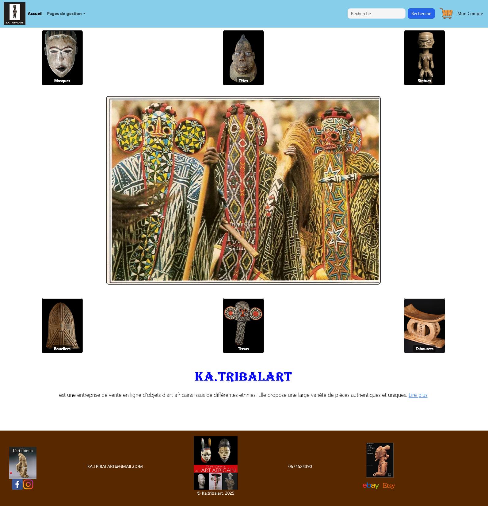
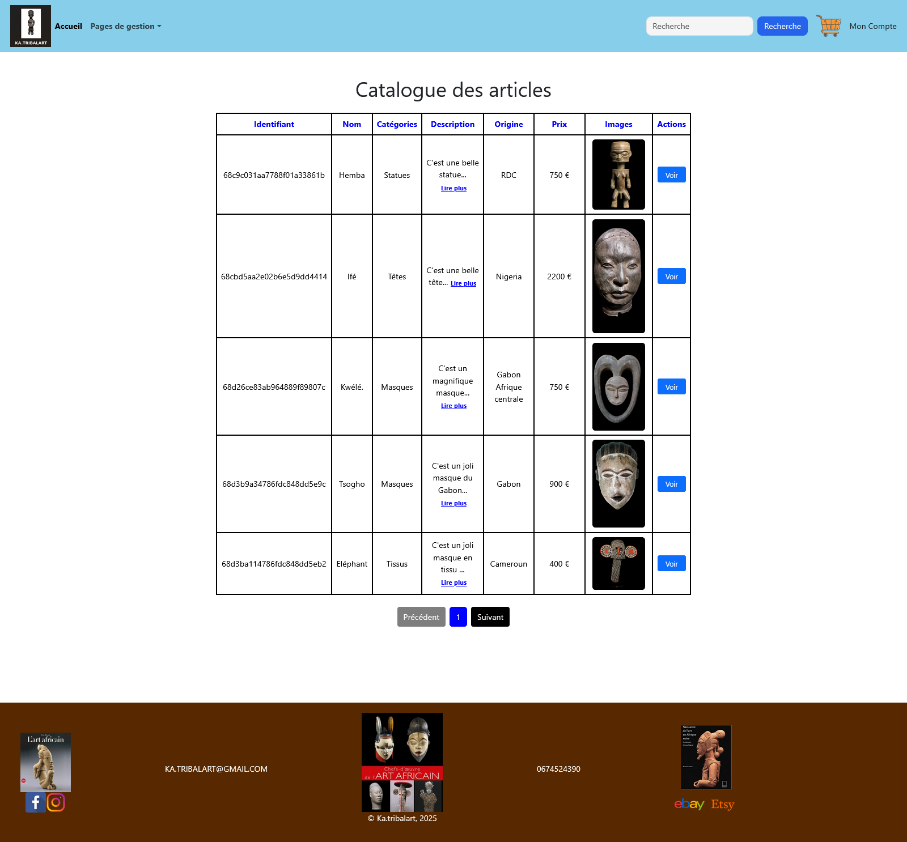
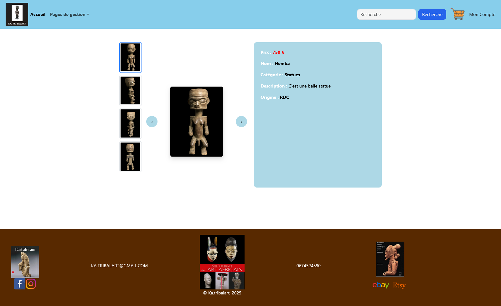
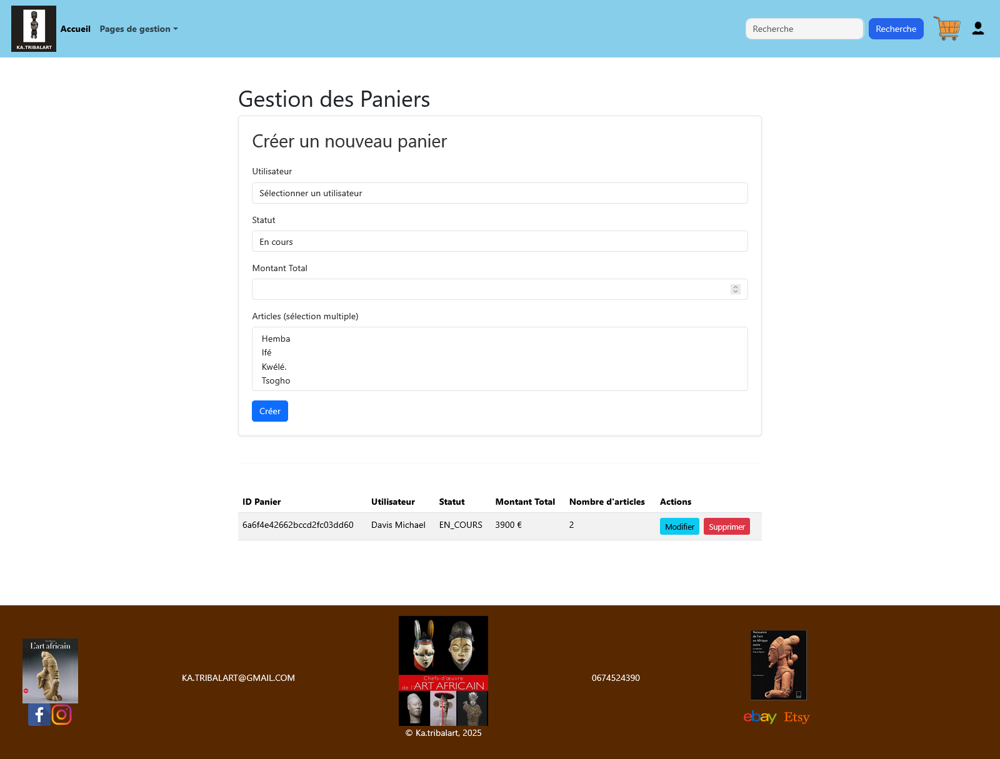

🎨 KA.TRIBALART - Plateforme E-commerce d'Objets d'Art Africain

## 📌 Présentation

**KA.TRIBALART** est une plateforme e-commerce full-stack dédiée à la vente d’objets d’art africain authentiques (masques, statues, têtes, etc.).

Le projet est développé avec :
- **Backend** : Node.js + Express.js + MongoDB
- **Frontend** : React.js (Vite)

Il propose une gestion complète des articles, un système d’authentification avec rôles, un panier d’achat et une simulation de paiement.

---

## 🎯 Objectifs

- Valoriser le patrimoine artistique africain
- Offrir une expérience d’achat fluide et moderne
- Permettre une administration complète des produits et commandes
- Respecter les bonnes pratiques (architecture MVC, sécurité JWT, validation des données)

---

## 🚀 Fonctionnalités principales

### Espace Visiteur / Client
- Navigation intuitive
- Catalogue avec pagination et recherche
- Fiche article détaillée (images multiples, description, prix, origine)
- Ajout au panier
- Passation de commande
- Simulation de paiement Stripe

### Espace Admin
- CRUD complet sur les articles
- Gestion des catégories
- Gestion des commandes
- Gestion des utilisateurs et rôles
- Upload d’images

### Authentification
- Inscription / Connexion
- Rôles : Admin / Client
- Protection des routes (middleware)

---

## 🛠️ Technologies utilisées

| Couche          | Technologies                                      |
|-----------------|---------------------------------------------------|
| **Backend**     | Node.js, Express.js, Mongoose, JWT, Multer       |
| **Frontend**    | React.js, Vite, Context API, Axios               |
| **Base de données** | MongoDB                                       |
| **Paiement**    | Stripe                                            |
| **Sécurité**    | Bcrypt, JWT, Validation (Joi)                     |
| **Autres**      | Bootstrap 5, Multer (upload images)               |

---

## 📁 Structure du projet

### Backend (Node.js)
```bash
backend/
├── controllers/          # article.controller.js, user.controller.js...
├── models/               # article.model.js, user.model.js...
├── routes/               # article.route.js...
├── middlewares/          # authMiddleware.js, adminMiddleware.js
├── validations/          # article.validation.js...
├── uploads/              # Images uploadées
├── db.js
└── server.js

### Frontend (React)
```bash
frontend/
├── src/
│   ├── components/       # Header, Footer, FormulaireArticle...
│   ├── pages/            # PageAccueil, PageCatalogue, PageArticle...
│   ├── contexts/         # AuthContext, PanierContext
│   ├── assets/
│   └── App.js
├── public/
│   └── images/
└── package.json

## 📷 Captures d'écran

### Page d'accueil


### Catalogue des articles


### Fiche Article détaillée


### Panier & Commandes


💻 Installation et Lancement

1. Cloner le projet

git clone https://github.com/ALIYOU65/react_fil_ka_tribalart.git
cd react_fil_ka_tribalart

git clone https://github.com/ALIYOU65/node_fil_ka_tribalart.git
cd node_fil_ka_tribalart

2. Backend

Bashcd backend
npm install
# Créer un .env avec MONGO_URI, JWT_SECRET, STRIPE_SECRET_KEY...
npm run dev

3. Frontend

Bashcd ../frontend
npm install
npm run dev

📈 Améliorations prévues

Paiement Stripe en production
Système d’avis et notation
Recherche avancée + filtres multicritères
Dashboard Admin avec statistiques
Déploiement complet (Vercel + Render/Railway)


👨‍💻 Auteur
KOUOTOU ALIYOU
Développeur Full Stack Web & Mobile

📧 kouotou26@gmail.com
🔗 GitHub